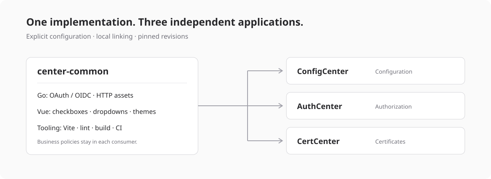

<p align="center">
  
</p>
<h3 align="center">Center Common</h3>
<p align="center">Shared Go and Vue infrastructure for ConfigCenter, AuthCenter and CertCenter.</p>

<p align="center">
  <a href="README.md">English</a> · <a href="README_zh.md">简体中文</a>
</p>

<p align="center">
  <a href="docs/guide.md">Documentation</a> · <a href="#quick-start">Quick Start</a> · <a href="docs/readme-format.md">README format</a>
</p>

<p align="center">
  <a href="https://github.com/OXeu/center-common/actions/workflows/ci.yml"></a>
  <a href="go.mod"></a>
  <a href="package.json"></a>
  <a href="LICENSE"></a>
</p>

## Preview



Shared packages and tooling used by the three independent applications.

## Features

- OAuth 2.0 / OIDC, PKCE and identity-provider integration.
- Embedded HTTP assets, Vue dropdowns and checkboxes, and shared theme tokens.
- One Vite, lint, test and CI toolchain with explicit consumer configuration.
- Live local linking and deliberate upgrades through pinned common revisions.

## Quick Start

This repository is a library and build toolchain. Run its checks first, then build a consumer for a running service. Install Git, Make, Node.js 24.15+ with npm, and Go 1.26.10. Git access to this repository is required.

```sh
git clone https://github.com/OXeu/center-common.git
cd center-common
npm ci
mkdir -p .tmp/bin
export TMPDIR="$PWD/.tmp"
GOBIN="$PWD/.tmp/bin" go install github.com/golangci/golangci-lint/v2/cmd/golangci-lint@v2.15.0
PATH="$PWD/.tmp/bin:$PATH" make check
```

### Run a consumer

```sh
git clone https://github.com/OXeu/configcenter.git ../configcenter
cd ../configcenter
make common-local COMMON_DIR=../center-common
make bootstrap
make build
CC_DB=file:.tmp/configcenter.db ./.tmp/bin/configcenter
```

Open http://127.0.0.1:8080; configure the consumer’s OAuth provider before signing in. See the [integration guide](docs/guide.md) for pinned builds, private repository access, upgrades and rollback.

## Star History

[](https://www.star-history.com/#OXeu/center-common&Date)

## LICENSE

Licensed under the [Apache License 2.0](LICENSE).
