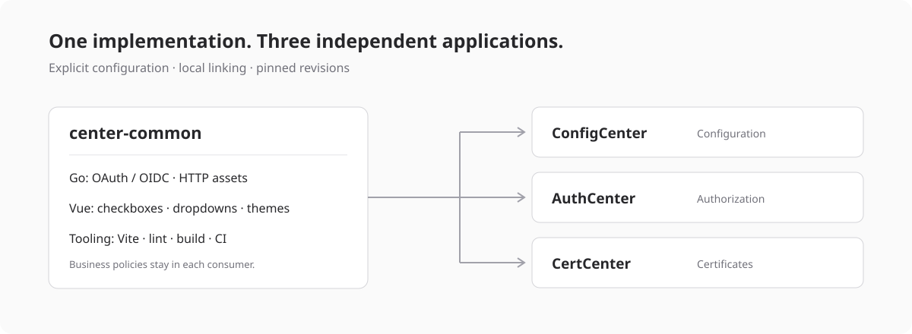

<p align="center">
  
</p>
<h3 align="center">Center Common</h3>
<p align="center">为 ConfigCenter、AuthCenter 和 CertCenter 提供共享的 Go 与 Vue 基础设施。</p>

<p align="center">
  <a href="README.md">English</a> · <a href="README_zh.md">简体中文</a>
</p>

<p align="center">
  <a href="docs/guide_zh.md">使用文档</a> · <a href="#快速开始">快速开始</a> · <a href="docs/readme-format.md">README 规范</a>
</p>

<p align="center">
  <a href="https://github.com/OXeu/center-common/actions/workflows/ci.yml"></a>
  <a href="go.mod"></a>
  <a href="package.json"></a>
  <a href="LICENSE"></a>
</p>

## 预览



三个独立应用共同使用的基础包、界面控件和开发工具。

## 功能

- OAuth 2.0 / OIDC、PKCE 和身份提供商接入。
- 嵌入式 HTTP 资源、Vue 下拉菜单与复选框、共享主题变量。
- 统一 Vite、lint、测试与 CI 工具链，业务配置由消费者显式传入。
- 本地源码实时联动，公共依赖通过锁定提交明确升级。

## 快速开始

本仓库提供基础库和构建工具链；先运行公共检查，再构建消费者即可启动服务。需要 Git、Make、带 npm 的 Node.js 24.15+、Go 1.26.10，以及本仓库的 Git 读取权限。

```sh
git clone https://github.com/OXeu/center-common.git
cd center-common
npm ci
mkdir -p .tmp/bin
export TMPDIR="$PWD/.tmp"
GOBIN="$PWD/.tmp/bin" go install github.com/golangci/golangci-lint/v2/cmd/golangci-lint@v2.15.0
PATH="$PWD/.tmp/bin:$PATH" make check
```

### 启动消费者

```sh
git clone https://github.com/OXeu/configcenter.git ../configcenter
cd ../configcenter
make common-local COMMON_DIR=../center-common
make bootstrap
make build
CC_DB=file:.tmp/configcenter.db ./.tmp/bin/configcenter
```

打开 http://127.0.0.1:8080；登录前需配置消费者的 OAuth 身份提供商。锁定构建、私有仓库访问、升级和回滚见[联动指南](docs/guide_zh.md)。

## Star History

[](https://www.star-history.com/#OXeu/center-common&Date)

## LICENSE

本项目采用 [Apache License 2.0](LICENSE) 开源协议。
